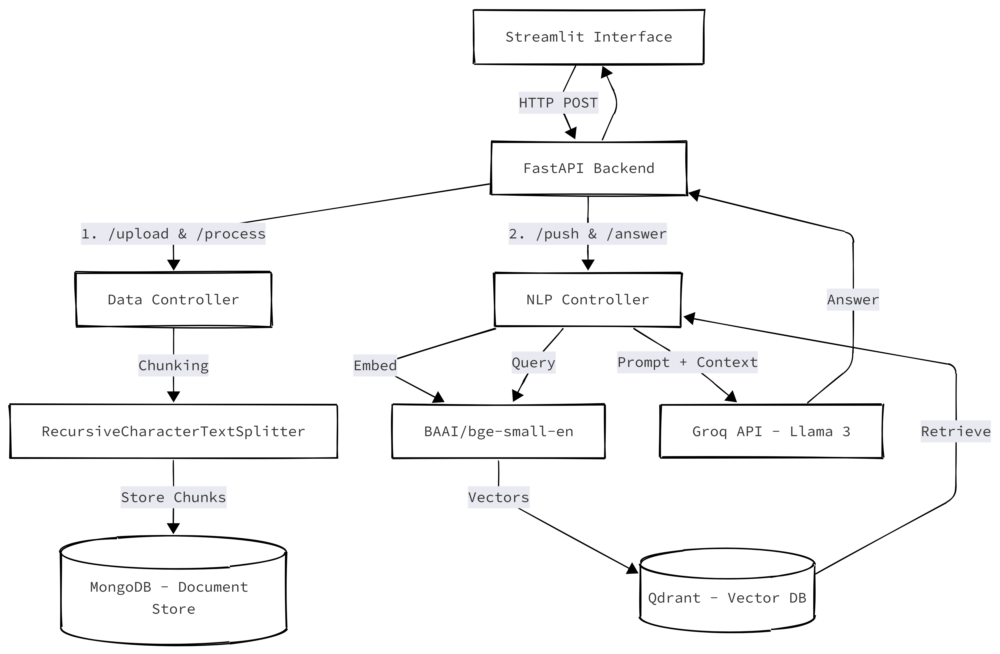

<p align="center">
  <h1 align="center">RAG</h1>
  <p align="center">
    A production-ready Retrieval-Augmented Generation system for intelligent document question-answering.
  </p>
</p>

<p align="center">
  <a href="https://www.python.org/downloads/"></a>
  <a href="https://fastapi.tiangolo.com/"></a>
  <a href="https://streamlit.io/"></a>
  <a href="https://www.docker.com/"></a>
  <a href="https://qdrant.tech/"></a>
  <a href="https://www.mongodb.com/"></a>
  <a href="#license"></a>
</p>

<p align="center">
  <a href="#description">Description</a> •
  <a href="#features">Features</a> •
  <a href="#system-architecture">Architecture</a> •
  <a href="#tech-stack">Tech Stack</a> •
  <a href="#installation">Installation</a> •
  <a href="#usage">Usage</a> •
  <a href="#api-reference">API</a> •
  <a href="#project-structure">Structure</a> •
  <a href="#contributing">Contributing</a> •
  <a href="#license">License</a> •
  <a href="#acknowledgments">Acknowledgments</a> 
</p>

---

## Description

**RAG** is a containerized Retrieval-Augmented Generation (RAG) backend engineered for intelligent document question-answering. The system enables users to upload unstructured documents (PDF, TXT), automatically process and chunk them, generate vector embeddings, and query the corpus using natural language that can receive context-aware, large language model-generated answers grounded in the uploaded documents' content.

Built as a project for the **Natural Language Processing** course at **FCIS-ASU**, RAG demonstrates a production-grade approach to combining information retrieval with large language model generation.

The primary use-case showcased is **CV-to-Job-Description matching**: upload candidate resumes and job postings, then ask natural-language questions and receive precise, source-attributed answers.

### Why RAG?

Traditional keyword search fails when users ask conceptual questions across documents. RAG bridges that gap by:

1. **Understanding intent**: Semantic embeddings capture meaning, not just keywords.
2. **Grounding answers in evidence**: Every answer is synthesized from retrieved document chunks, reducing hallucination.

---

## Features

| Category | Feature | Details |
|----------|---------|---------|
| **Document Ingestion** | Multi-format upload | PDF and plain-text files up to 10 MB |
| **Chunking** | Recursive character splitting | Configurable `chunk_size` (default: 500) and `overlap` (default: 50) |
| **Embedding** | Local vector generation | `BAAI/bge-small-en` (384-dim) via `sentence-transformers` no external API calls |
| **Retrieval** | Semantic similarity search | Cosine similarity over Qdrant vector index with top-k retrieval |
| **Generation** | LLM-powered answers | Groq API (`llama-3.1-8b-instant`) with prompt templates and chat history |
| **Multilingual** | Arabic + English | Arabic text reshaping, BiDi reordering, and locale-aware prompt templates |
| **Architecture** | Clean multi-tier design | Controller → Model → Store separation with Factory Pattern |
| **Deployment** | Fully containerized | Single `docker-compose up` spins up FastAPI + MongoDB + Qdrant |
| **UI** | Streamlit interface | Document upload, real-time processing feedback, and conversational Q&A |

---

## System Architecture

The system follows a clean **multi-tier architecture** containerized with Docker Compose.

<p align="center">
  
</p>

### Component Breakdown

| Layer | Component | Responsibility |
|-------|-----------|----------------|
| **Frontend** | Streamlit (`interface.py`) | User-friendly document upload and chat interface |
| **Web Layer** | FastAPI (`routes/`) | RESTful API endpoints with Swagger documentation |
| **Controller Layer** | `DataController`, `NlpController`, `ProcessController` | Business logic orchestration |
| **Data Layer** | MongoDB 7.0 | Operational database for files, chunks, and project metadata |
| **Vector Layer** | Qdrant | High-performance vector similarity search |
| **Provider Layer** | LLM Factory, VectorDB Factory | Pluggable connectors via Factory + Strategy patterns |

---

## Tech Stack

### Backend
| Technology | Purpose | Version |
|------------|---------|---------|
| [Python](https://www.python.org/) | Core language | 3.11+ |
| [FastAPI](https://fastapi.tiangolo.com/) | Async web framework & REST API | 0.110.2 |
| [Uvicorn](https://www.uvicorn.org/) | ASGI server | 0.29.0 |
| [Pydantic](https://docs.pydantic.dev/) | Data validation & settings management | v2 |
| [Motor](https://motor.readthedocs.io/) | Async MongoDB driver | 3.4.0 |

### AI / NLP
| Technology | Purpose | Version |
|------------|---------|---------|
| [LangChain](https://python.langchain.com/) | Document loading & text splitting | 0.1.20 |
| [Sentence-Transformers](https://www.sbert.net/) | Local embedding generation (`BAAI/bge-small-en`) | ≥ 2.6.0 |
| [OpenAI SDK](https://github.com/openai/openai-python) | LLM client (Groq-compatible) | 1.35.15 |
| [PyMuPDF](https://pymupdf.readthedocs.io/) | PDF text extraction | 1.24.3 |
| [arabic-reshaper](https://github.com/mpcabd/python-arabic-reshaper) | Arabic text normalization | ≥ 3.0.0 |
| [python-bidi](https://github.com/MichaelAqworthy/python-bidi) | Bidirectional text support | ≥ 0.4.2 |

### Infrastructure
| Technology | Purpose | Version |
|------------|---------|---------|
| [Docker](https://www.docker.com/) | Containerization | Latest |
| [Docker Compose](https://docs.docker.com/compose/) | Multi-service orchestration | v2 |
| [MongoDB](https://www.mongodb.com/) | Document store | 7.0 |
| [Qdrant](https://qdrant.tech/) | Vector database | Latest |

### Frontend
| Technology | Purpose | Version |
|------------|---------|---------|
| [Streamlit](https://streamlit.io/) | Interactive web UI | ≥ 1.33.0 |

---

## Installation

### Prerequisites

Ensure the following tools are installed on your system:

| Tool | Download | Verify |
|------|----------|--------|
| Docker Desktop | [docker.com](https://www.docker.com/products/docker-desktop) | `docker --version` |
| Python 3.11+ | [python.org](https://www.python.org/downloads/) | `python --version` |
| Git | [git-scm.com](https://git-scm.com/download/win) | `git --version` |

### Quick Start (3 Steps)

```bash
git clone https://github.com/AhmedAlian7/RAG.git
cd RAG

cd docker
cp .env.example .env  
docker-compose up -d

cd ../src
cp .env.example .env
pip install -r requirements.txt
uvicorn main:app --reload --port 5000
```


### Docker Compose (Full Deployment)

To deploy the entire stack (backend + databases) with a single command:

```bash
cd docker
cp .env.example .env
cp ../src/.env.example ../src/.env # set your api key
docker-compose up -d --build
```

This starts:
| Service | URL |
|---------|-----|
| FastAPI Backend | [http://localhost:5000](http://localhost:5000) |
| Swagger API Docs | [http://localhost:5000/docs](http://localhost:5000/docs) |
| Qdrant Dashboard | [http://localhost:6333/dashboard](http://localhost:6333/dashboard) |
| MongoDB | `localhost:27007` |

---

## Usage

### Via the Streamlit UI

1. **Open** the Streamlit app at [http://localhost:8501](http://localhost:8501).
2. **Set a workspace name** in the sidebar (e.g., `my-resumes`).
3. **Upload** one or more PDF/TXT documents in the **Upload** tab.
4. **Wait** for the automated pipeline: Upload → Chunk → Embed → Index.
5. **Switch** to the **Chat** tab and ask questions about your documents.

### Via the REST API

```bash
# 1. Upload a document
curl -X POST "http://localhost:5000/api/v1/data/upload/my-project" \
  -F "file=@resume.pdf"

# 2. Process and chunk the document
curl -X POST "http://localhost:5000/api/v1/data/process/my-project" \
  -H "Content-Type: application/json" \
  -d '{"file_id": "<file_id>", "chunk_size": 500, "overlap": 50, "do_reset": 0}'

# 3. Embed and push chunks to the vector index
curl -X POST "http://localhost:5000/api/v1/nlp/index/push/my-project" \
  -H "Content-Type: application/json" \
  -d '{"do_reset": 1}'

# 4. Ask a question (RAG pipeline)
curl -X POST "http://localhost:5000/api/v1/nlp/index/answer/my-project" \
  -H "Content-Type: application/json" \
  -d '{"text": "What programming languages does the candidate know?", "top_k": 5, "language": "en"}'
```

---

## API Reference

All endpoints are prefixed with `/api/v1`. Full interactive documentation is available at [`/docs`](http://localhost:5000/docs) when the server is running.

### Data Management

| Method | Endpoint | Description |
|--------|----------|-------------|
| `POST` | `/data/upload/{project_id}` | Upload a document (PDF/TXT) to a workspace |
| `POST` | `/data/process/{project_id}` | Parse, preprocess, and chunk the uploaded document |

### NLP & Retrieval

| Method | Endpoint | Description |
|--------|----------|-------------|
| `POST` | `/nlp/index/push/{project_id}` | Embed all chunks and push to Qdrant |
| `GET`  | `/nlp/index/info/{project_id}` | Get index status and vector count |
| `POST` | `/nlp/index/search/{project_id}` | Perform semantic similarity search |
| `POST` | `/nlp/index/answer/{project_id}` | Execute the full RAG pipeline (retrieve + generate) |

### Health

| Method | Endpoint | Description |
|--------|----------|-------------|
| `GET`  | `/health` | Application health check |

---

## Groq API Setup

1. Navigate to the [Groq Cloud Console](https://console.groq.com/keys).
2. Create an account or log in.
3. Select **API Keys** from the navigation menu.
4. Click **Create API Key**, name it (e.g., `rag-dev`), and click **Submit**.
5. **Copy the key immediately** (starts with `gsk_`). It will not be shown again.
6. Paste the key into your `src/.env` file:

```env
GROQ_API_KEY="gsk_YOUR_KEY_HERE"
GROQ_API_BASE="https://api.groq.com/openai/v1"
GENERATE_RESPONSE_MODEL="llama-3.1-8b-instant"
ALT_GENERATE_RESPONSE_MODEL="llama3-70b-8192"
```

---

## Project Structure

```
RAG/
├── README.md
├── .gitignore
├── docker/                         
│   ├── docker-compose.yaml               
│   ├── .env.example                      
│   └── mongodb/                        
│
├── docs/                            
│   ├── RAG-SYS-ARCH.png                  
│   └── REPORT.md                         
│
└── src/                               
    ├── main.py                           
    ├── interface.py                      
    ├── Dockerfile                        
    ├── requirements.txt                  
    ├── .env.example                      
    │
    ├── helpers/
    │   └── config.py                     
    │
    ├── controllers/                   
    │   ├── BaseController.py             
    │   ├── DataController.py             
    │   ├── FileController.py             
    │   ├── ProcessController.py          
    │   ├── NlpController.py              
    │   └── ProjectController.py          
    │
    ├── models/                        
    │   ├── DataBaseModel.py              
    │   ├── ProjectModel.py               
    │   ├── ChunkModel.py                 
    │   ├── enums/                        
    │   └── db_schemes/                   
    │       ├── project.py                
    │       └── data_chunk.py             
    │
    ├── routes/                        
    │   ├── base.py                       
    │   ├── data.py                       
    │   ├── nlp.py                        
    │   └── schema/                       
    │       ├── data.py                   
    │       └── nlp.py                    
    │
    ├── stores/                        
    │   ├── llm/
    │   │   ├── LLMInterface.py           
    │   │   ├── LLMFactory.py             
    │   │   ├── provider/
    │   │   │   ├── OpenAIProvider.py      
    │   │   │   └── EmbeddingProvider.py   
    │   │   └── template/
    │   │       ├── template_parser.py    
    │   │       └── locales/
    │   │           ├── en/rag.py         
    │   │           └── ar/rag.py         
    │   └── vectordb/
    │       ├── VectorDBInterface.py       
    │       ├── VectorDBFactory.py         
    │       └── provider/
    │           └── QDrantDB.py            
    │
    └── evaluation/                    
        ├── results.json                  
        └── failure_analysis.md           
```

---

## Contributing

Contributions are welcome! Please follow these guidelines:

1. **Fork** the repository.
2. **Create** a feature branch:
   ```bash
   git checkout -b feat/your-feature-name
   ```
3. **Commit** your changes with clear, descriptive messages:
   ```bash
   git commit -m "feat: add MMR diversity re-ranking to retrieval pipeline"
   ```
4. **Push** to your fork:
   ```bash
   git push origin feature/your-feature-name
   ```
5. **Open** a Pull Request against the `main` branch.

### Code Standards

- Follow [PEP 8](https://peps.python.org/pep-0008/) style guidelines.
- Use type hints for function signatures.
- Maintain the existing Controller → Model → Store architecture.
- Add docstrings to public classes and methods.

---

## License

This project is licensed under the **MIT License**. See the [LICENSE](LICENSE) file for details.

---

## Acknowledgments

This project was developed as part of the **Natural Language Processing (NLP)** course at the **Faculty of Computer and Information Sciences, Ain Shams University (FCIS-ASU)**.

Special thanks to:

- **FCIS-ASU NLP Course Staff**: For the course curriculum, project guidance, and technical mentorship throughout the development of this system.
- **Teaching Assistants**: For their hands-on support, code reviews, and constructive feedback that significantly improved the quality of this project.

---

<p align="center">
  <strong>Connect with me</strong>
</p>

<p align="center">
  <a href="https://www.linkedin.com/in/ahmedalian7/"></a>
</p>

<p align="center">
  <sub>⭐ If this project helped you, consider giving it a star!</sub>
</p>