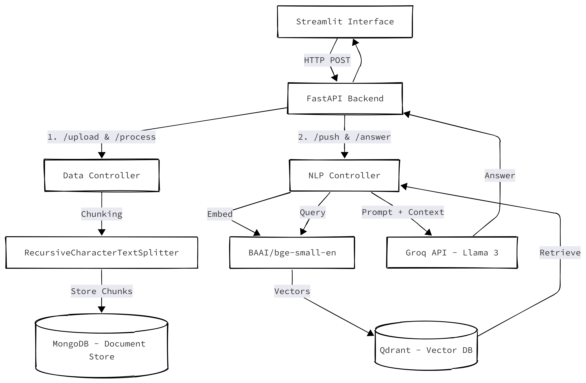

# Mini-RAG System Technical Report

## Executive Summary
The Mini-RAG project is a containerized Retrieval-Augmented Generation (RAG) backend engineered to solve the domain problem of intelligent CV-to-job-description matching. Built with a FastAPI backend and a Streamlit UI, the system ingests unstructured text and PDF documents, processes and chunks the content, and pushes vector embeddings to Qdrant. At query time, the system performs a hybrid semantic search to retrieve the most relevant chunks, leveraging an external LLM (Groq API, `llama-3.1-8b-instant`) to synthesize a context-aware answer. The system is designed with modularity in mind, using the Factory pattern for seamless swapping of LLM and Vector Database providers, and features multilingual support including BiDi-compliant Arabic text processing.

## System Architecture

The architecture follows a clean MVC-inspired multi-tier design, fully containerized using Docker.



### Component Breakdown
1. **Frontend**: Streamlit application (`interface.py`) providing a user-friendly chat and document upload interface.
2. **Web Layer**: FastAPI router (`routes/`) exposing REST endpoints.
3. **Controller Layer**: Business logic orchestration (`DataController.py`, `NlpController.py`, `ProcessController.py`).
4. **Data Layer**: 
    - **MongoDB**: Acts as the primary operational database, storing raw files, processed chunks, and project metadata.
    - **Qdrant**: High-performance vector database used for semantic similarity search.
5. **Provider Layer**: Factory-instantiated connectors for the LLM (`GroqProvider.py`, `OpenAIProvider.py`) and VectorDB (`QDrantDB.py`).

## API Documentation

The backend exposes a RESTful API under the `/api/v1` prefix.

### 1. Data Management Endpoints

**POST `/data/upload/{project_id}`**
- **Description**: Uploads a document to a specific project workspace.
- **Payload**: `multipart/form-data` with a `file` field (`text/plain` or `application/pdf`).
- **Response**: `{"file_id": "string", "file_path": "string"}`

**POST `/data/process/{project_id}`**
- **Description**: Parses, preprocesses (including Arabic reshaping), and chunks the uploaded file into MongoDB.
- **Payload (JSON)**:
  ```json
  {
    "project_id": "file_id_returned_from_upload",
    "chunk_size": 500,
    "overlap": 50,
    "do_reset": 0
  }
  ```
- **Response**: `{"inserted_chunks": int}`

### 2. NLP & Retrieval Endpoints

**POST `/nlp/index/push/{project_id}`**
- **Description**: Embeds all chunks associated with a project in MongoDB and pushes them to Qdrant.
- **Payload (JSON)**:
  ```json
  {
    "do_reset": 1
  }
  ```
- **Response**: `{"message": "Successfully pushed X chunks to index."}`

**POST `/nlp/index/answer/{project_id}`**
- **Description**: Executes the end-to-end RAG pipeline (embed query -> retrieve top-k chunks -> generate LLM answer).
- **Payload (JSON)**:
  ```json
  {
    "text": "What is the candidate's Python experience?",
    "top_k": 5,
    "language": "en"
  }
  ```
- **Response**:
  ```json
  {
    "answer": "string",
    "chat_history": ["list of previous messages"],
    "full_prompt": "string (for debugging)"
  }
  ```

## Design Justifications

### Embedding Model: `BAAI/bge-small-en`
The `BAAI/bge-small-en` model was chosen because it provides a near-optimal balance of retrieval accuracy and computational efficiency for local deployment. With a dimensionality of 384, it requires significantly less RAM/VRAM than 768-dim models (e.g., `e5-base` or `instructor-xl`), making it ideal for containerized execution without dedicated GPUs. Despite its small size, it consistently ranks at the top of the Massive Text Embedding Benchmark (MTEB) for its weight class.

### Chunking Strategy: Recursive Character Splitting
We implemented `RecursiveCharacterTextSplitter` with a default `chunk_size` of 500 characters and an `overlap` of 50 characters. 
- **Chunk Size (500)**: Resumes and job descriptions are highly structured but dense. A 500-character window is small enough to isolate distinct concepts (e.g., separating the "Education" section from "Experience") reducing semantic noise in the vector embedding.
- **Overlap (50)**: An overlap of 10% ensures that critical context (like a job title acting as a header for bullet points) is not lost across chunk boundaries.

## Docker Deployment Instructions

The system is fully containerized using Docker Compose, orchestrating the FastAPI backend, MongoDB, and Qdrant.

1. **Environment Setup**:
   Navigate to the `docker/` directory and configure the environment variables:
   ```bash
   cd docker
   cp .env.example .env
   # Ensure MONGO_USER and MONGO_PASSWORD match the credentials in src/.env
   ```

2. **Configure Application Variables**:
   In the root `src/` directory, create your `.env` file from the example:
   ```bash
   cp src/.env.example src/.env
   # Add your Groq API key: GROQ_API_KEY=gsk_...
   ```

3. **Deploy the Infrastructure**:
   From the `docker/` directory, spin up the backend and database services:
   ```bash
   docker-compose up -d --build
   ```
   *This starts:*
   - FastAPI Backend: `http://localhost:5000`
   - Qdrant Dashboard: `http://localhost:6333/dashboard`
   - MongoDB: `localhost:27007`

4. **Run the Streamlit UI**:
   In a separate terminal, start the frontend (requires local Python environment):
   ```bash
   cd src
   pip install -r requirements.txt
   streamlit run interface.py
   ```
   *Access the UI at `http://localhost:8501`.*
